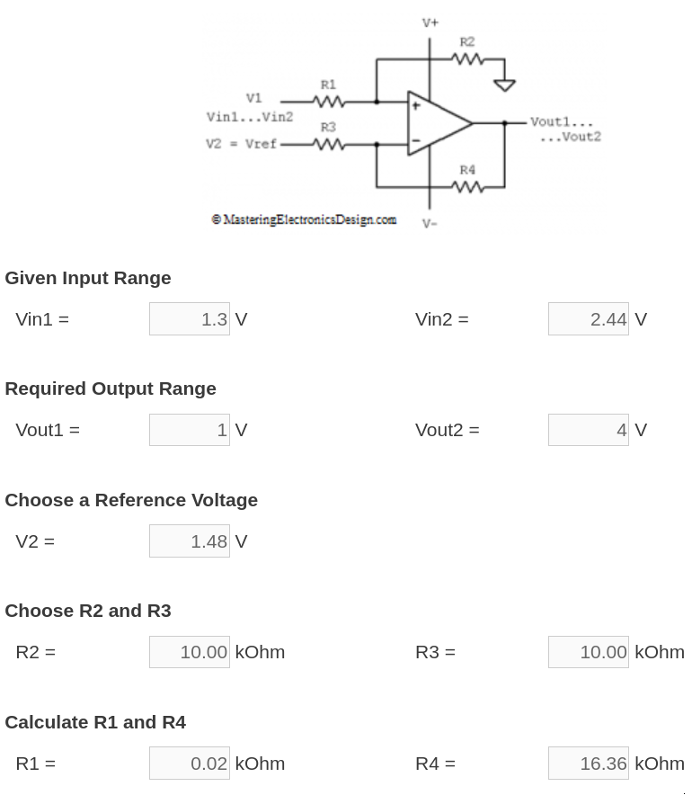
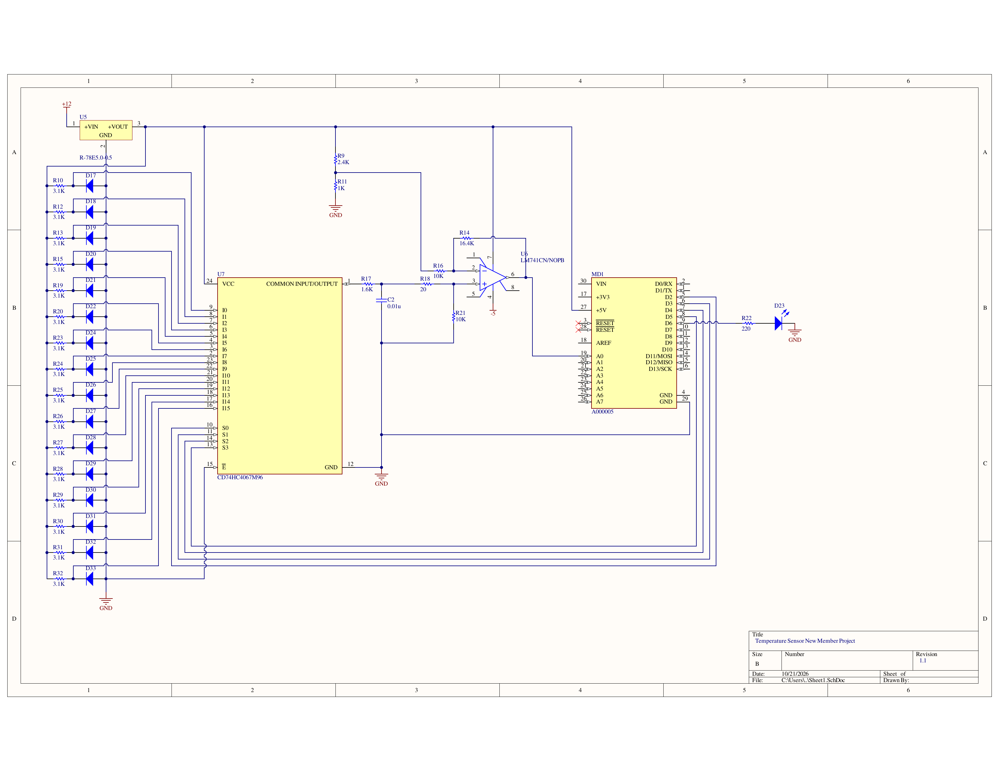
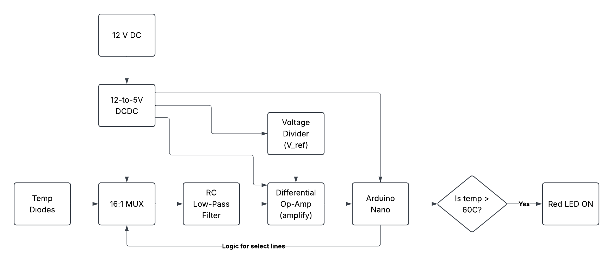

# [RFR 2027 Electronics] New Member Project Design Report

**Team 1:** Hank Habashy (hnh34), Rebekah Han (reh129), Shiven Jariwala (sjj105), and Dhruv Ajwani (daa307)

---

# 1. Revision Log

|Editor|Date|Revision|
|---|---|---|
|Rebekah Han|2026-10-16|1|
|Rebekah Han|2026-10-28|2|

# 2. Purpose

To build a temperature sensor, taking analog input and then converting it into digital to output them over the I2C bus.

# 3. Parties Involved

|Name|Team Role|Report Role|
|---|---|---|
|Rebekah Han|New Member|Author|
|Hank Habashy|New Member||
|Shiven Jariwala|New Member||
|Dhruv Ajwani|New Member||

# 4. Research

Firstly, the temperature diodes involved following a similar setup as to what was written in the datasheet. Given feedback, we plan to use a common pull up on the MUX output. The datasheet states that the forward current is I_reg = \frac{V_CC - V_out}{R}, and we plan to use the 680 Ω resistor as shown in the datasheet. This suits our case because at the minimum temperature, the I_reg = (5 - 2.44) / 680 = 3.76 mA. At the max, the I_reg = (5 - 1.3) / 680 = 5.44 mA. Thus, the I_reg will always be above the minimum operating current at 0.4 mA and below the max operating current at 15 mA.

Given that our temperature sensors' output voltage ranges from 1.30 V to 2.44 V and that the Arduino's ADC has 10-bit resolution with a default reference voltage of 5 V, we can shift and amplify the signals from the temperature sensors in such a way that its range becomes 1 - 4 V. Keeping this in mind, we can also use an RC low-pass filter to keep lower frequency ranges since temperature signals change slowly in comparison to other signals. This will help filter out any electrical noise. Using [this low pass filter calculator](https://www.digikey.com/en/resources/conversion-calculators/conversion-calculator-low-pass-and-high-pass-filter), to achieve a cutoff frequency at ~10 kHz, our resistor would need to be 1.6 kΩ and the capacitance would need to be 0.01 μF. This bandwidth excludes frequencies > 10 kHz. Common values for the cutoff frequency are between 1 - 20 kHz. This plays a role into the delay in the Arduino code because we need to find the time it takes for the capacitor to charge the voltage we want to sample. To do this, we can first find the time constant of the RC filter by multiplying R and C, which is 16 microseconds (µs). Then, we would need to find the time (or the factor by which) it takes for the capacitor to charge to match the resolution of the Nano's 10-bit ADC. (Generally, the higher the resolution, the more time it takes for the voltage to settle.) This can be found by solving for t (time) in the following RC step-response equation: V(t) = V_t * (1-e^{\frac{t}{\tau}}). We would set V(t) to 0.9995 because we want our reading is accurate to within half of the LSB (least significant bit of error). The LSB is 1/1024 (as a 10-bit ADC has 2^10 voltage steps). So 1 - 1/(2*1024) = 0.9995. When solving the equation for t, we get the relationship that 7.6 * \tau. We can round down to 7 because we are still quite accurate. When we plug in our value for \tau, the time is 112 µs. Thus, it takes 112 µs for the filter to settle. We can add a delay of 115 µs in between multiplexing.

To handle amplification, a differential op-amp can be used to handle both level shifting and amplification. We would like the lowest temperature (i.e. -40°C) to be 4 V instead of the original 2.44 V (from the diode) and the highest temperature (120°C) to be 1 V instead of 1.30 V. Thus the gain for the op-amp will be 2.63 (= [4V - 1V]/[2.44V - 1.3V]). We used this [differential amplifier calculator](https://masteringelectronicsdesign.com/differential-amplifier-calculator-2/) to help us build the op-amp circuit. The image below shows the circuit and the values to use.



In addition, to handle obtaining the V_REF = 1.48 V, we plan to use a voltage divider. The V_REF was computed by using the given equation: V_out = A(V_in - V_ref) + V_ref, where A is the gain. In our case, V_in = 1.3 V and V_out = 1.0 V.

The multiplexer will handle from what diode we will read from at a time. The 16:1 multiplexer has 4 select pins, which allow for addressing in a way. It is helpful to think of the 4 pins corresponding to a number in binary (e.g. 0000 = 0, 0001 = 1, 0010 = 2, etc). Each number corresponds to one input pin. So if the select pins were set to 0000, then the output of the multiplexer would return data from I_0 or input "pin" 0. We can take advantage of this addressing with the Arduino Nano. From the Nano, we can send 1s or 0s to the 4 select pins of the multiplexer. A program can be written to cycle through all of the temperature diodes from 0 (0000) through 15 (1111) and grab the output every time a new set of bits is sent to the multiplexer. From there calculating the highest temperature, average temperature, and other analysis can be done.

The 12-to-5 V step-down converter is able to put out 2.5 W. By summing the power consumption of elements connected to the 5V line, the estimated sum turns out to be 1.78 W, which is < 2.5 W. Since each temperature diode is 3.1 kΩ and is receiving 5 V, all 16 diodes dissipate about 0.129 W. The multiplexer consumes a max of 0.00004 W. The voltage divider consumes 0.00735 W. The op-amp is estimated to consume 0.05 W when the V_s is 15 V. Since ours is at 5 V, we will consume less power than 0.05 W. The Arduino Nano is estimated to consume a total of 1.6 W in our case because we are using 5 digital pins. [Someone](https://arduino.stackexchange.com/questions/926/what-is-the-maximum-power-consumption-of-the-arduino-nano-3-0) calculated that the Nano consumes 1.4 W to turn on, as the datasheet states the typical power consumption is TBC. The additional 0.2 W comes from 5 digital pins consuming each 40 mA max. Thus, summing all of the numbers comes out to 1.78 W.

# 5. Findings

## Parts

### Given Parts

- 16:1 multiplexer CD74HC4067
- Arduino Nano
- 12 to 5 V DCDC
- 16 temperature-sensitive diodes
- Red LED
- Breadboard
- Jumper cables
- Resistors

### Additional Parts

The following lists parts not listed in the writeup, but are a part of our design:
- Op-amp LM741
- Capacitor: 0.01 µF
- 12V to 5V converter: Recom R-78E5.0-0.5

## Schematic

The image below features our schematic.



## Schematic Flow Chart

The image below is our schematic flow chart. The analog signal from the temperature diodes are fed through the multiplexer, which gets through the RC low pass filter, is then amplified, and then fed to the Arduino Nano. The signal is translated into a digital signal, which will be made available over I2C on a digital pin. If the temperature is > 60°C, then the red LED will turn on.



## Code

The program is small, so below is the program in its entirety. Bit shifting is used to create 0 through 15 in binary for the select lines. More information on using linear interpolation is found above the `calculateTemp()` function definition.

The `VOLTAGE_OFFSET` was calculated by V_min_out - (GAIN * V_min), or 1.0 - (2.63 * 1.30). `voltDiode` was computed by taking the voltage after amplification and processing through the Arduino's ADC, then subtracting it by the `VOLTAGE_OFFSET`, and then dividing it by the `GAIN`.

```C
#include <Wire.h>

const int TEMP_PIN = 0;
const int LED_PIN = 13;
const int NUM_TEMP_SENSORS = 16;
const float TEMP_MAX = 60.0;

const float GAIN = 2.63;
const float VOLTAGE_OFFSET = -2.419;

const int temps[33] = { -40, -35, -30, -25, -20, -15, -10, -5, 0, 5, 10, 15, 20, 25, 30, 35, 40, 45, 50, 55, 60, 65, 70, 75, 80, 85, 90, 95, 100, 105, 110, 115, 120 };
const float volts[33] = { 2.44, 2.42, 2.40, 2.38, 2.35, 2.32, 2.27, 2.23, 2.17, 2.11, 2.05, 1.99, 1.92, 1.86, 1.80, 1.74, 1.68, 1.63, 1.59, 1.55, 1.51, 1.48, 1.45, 1.43, 1.40, 1.38, 1.37, 1.35, 1.34, 1.33, 1.32, 1.31, 1.30 };

byte selectArray[16][4]; // Hold 0000 in selectArray[0][0-3], 0001 in [1][0-3], etc.
const int selectLines[4] = { 5, 4, 3, 2 }; // Pins to multiplexer select lines

void selectMuxChannel(int channelNum);
float calculateTemp(float voltDiode);

void setup() {
    pinMode(LED_PIN, OUTPUT);
    for (int i = 0; i < 4; i++) {
        pinMode(selectLines[i], OUTPUT);
    }

    pinMode(TEMP_PIN, INPUT);

    for (int num = 0; num < 16; num++) {
        for (int bit = 3; bit >= 0; bit--) {
            selectArray[num][3 - bit] = (num >> bit) & 1; // Bit shift num by bit times and mask the lowest bit
        }
    }

    Wire.begin();
    Serial.begin(9600);
}

void loop() {
    float highestTemp = 0.0;
    uint8_t highestTempChannel = 0;

    // For each MUX channel
    for (int i = 0; i < NUM_TEMP_SENSORS; i++) {
        selectMuxChannel(i);
        delayMicroseconds(115);
        float tmpTemp = analogRead(TEMP_PIN);
        // Calculate the V_diode (V_out in datasheet of temperature diodes)
        float voltDiode = (tmpTemp - VOLTAGE_OFFSET) / GAIN;
        // Lookup/linear interpolate corresponding temperature in table
        float realTemp = calculateTemp(voltDiode);
        if (realTemp > highestTemp) {
            highestTemp = realTemp;
            highestTempChannel = i;
        }
        // Turn on LED if the temperature is too high
        if (realTemp > TEMP_MAX) {
            digitalWrite(LED_PIN, HIGH);
        }
    }

    // Report highest temperature via I2C
    // First 4 bytes are the highestTemp and the 5th byte is the highestTempChannel
    Wire.beginTransmission(0x67);
    Wire.write((uint8_t *)&highestTemp, sizeof(highestTemp));
    Wire.write(highestTempChannel);
    Wire.endTransmission();
    delay(500);
}

void selectMuxChannel(int channelNum) {
    for (int i = 0; i < 4; i++) {
        digitalWrite(selectLines[i], selectArray[channelNum][i]);
    }
}

/**
*  calculateTemp finds the range in which voltDiode is valid in so that
*  linear interpolation can be performed. The equation used is:
*  y = y_1 + [(x - x_1) * \frac{y_2 - y_1}{x_2 - x_1}]
*  y = return val (temperature)
*  x = voltDiode
*  x_1 = volts[i]
*  x_2 = volts[i + 1]
*  y_1 = temps[i]
*  y_2 = temps[i + 1]
*  The function returns the temperature.
*/
float calculateTemp(float voltDiode) {
    if (voltDiode >= volts[0]) {
        return temps[0];
    }
    if (voltDiode <= volts[32]) {
        return temps[32];
    }

    for (int i = 0; i <= 33; i++) {
        if (voltDiode <= volts[i] && voltDiode  >= volts[i + 1]) {
            float fraction = (temps[i + 1] - temps[i]) / (volts[i + 1] - volts[i]);
            float mul = (voltDiode - volts[i]) * fraction;
            return temps[i] + mul;
        }
    }
}
```

# 6. Conclusion

Implementing a low-pass RC circuit and a differential op-amp to achieve signal conditioning is one way to address the core requirements of the 2027 Electronics New Member project.
