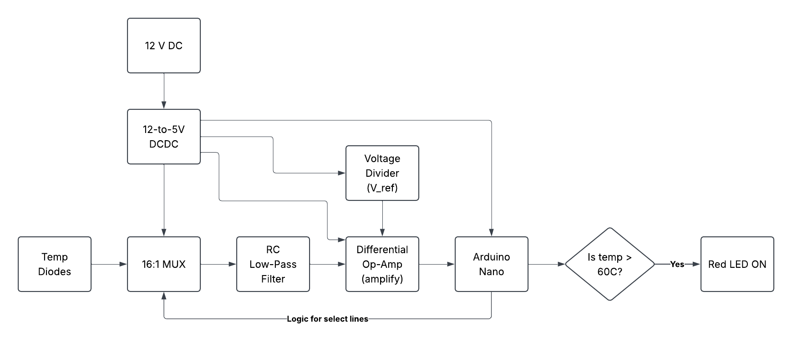
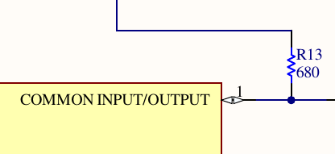
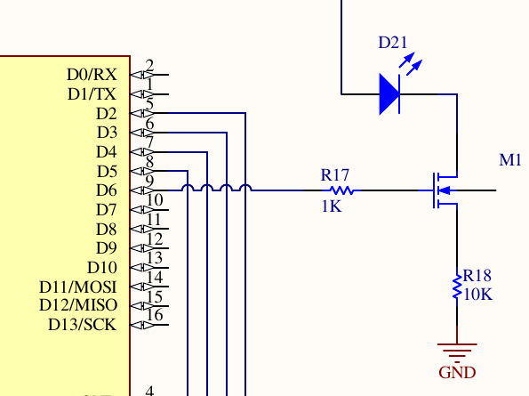

# New Member Design Presentation

**Team 1:** Rebekah Han, Hank Habashy, Shiven Jariwala, and Dhruv Ajwani

---

# Outline
- Schematic + flowchart
- Major changes
- Schematic details + code
- Troubleshooting

---

# Schematic Flow Chart



---

# Schematic


---

# Major Changes
- RC filter justification & simulation
- Common pull-up on the MUX output
- Pull-up justification
- Justfy delay
- Use MOSFET for LED

---

## RC Low-Pass Filter Justification
- Purpose is to let lower frequency ranges through. We chose a 10 kHz cutoff because we want to include changing temperature signals, which happens at < 10,000 times/sec. Only really fast noise gets filtered out.
- Physical temperature changes usually occur below 1 Hz in a room or outside (i.e. a second or two).
- Not lower because this keeps our R and C smaller, which allows the filter to settle quickly for the ADC. (Justification for delay in code given soon.)

---

## RC Low-Pass Filter Simulation

---

## Pull-Up on the MUX Output

- Instead of individual pull-ups for each temp diode, we used a common pull-up on the MUX output
- 680Ω pulled from datasheet



---

## Delay in Code Justification

Find the time it takes for the capacitor to charge so that we can take a sample.
1. Find the time constant of the RC filter: $\tau = R * C = 16µs$
    - $R=1.6K$ and $C=0.01\mu F$
2. Find the time/factor by which it takes for the capacitor to charge to match the resolution of the Nano's 10-bit ADC: solve for $t$: $V(t) = V_t * (1-e^{-\frac{t}{\tau}}).$

---

1. Set $V(t) = 0.9995 * V_t$ b/c we want our reading to be accurate w/in half of the LSB of errror ($\frac{1}{1024}$ because the 10-bit ADC has $2^{10}$ voltage steps). Thus $1 - \frac{1}{(2*1024)} = 0.9995$.

2. $0.99951 * V_t = V_t * (1-e^{-\frac{t}{\tau}})$

3. $0.99951 = 1-e^{-\frac{t}{\tau}}$

4. $e^{\frac{t}{\tau}} = 1-0.99951 = 0.00049$

5. $t=7.62*\tau$.

6. $7.62 * 16\mu s \approx 122 \mu s$

---

- Takes about $122 \mu s$ for the filter to settle.
- Added a $125 \mu s$ delay in the code.

```cpp
for (int i = 0; i < NUM_TEMP_SENSORS; i++) {
        selectMuxChannel(i);
        delayMicroseconds(125); // HERE!
        float tmpTemp = analogRead(TEMP_PIN);
        // Calculate the V_diode (V_out in datasheet of temperature diodes)
        float voltDiode = (tmpTemp - VOLTAGE_OFFSET) / GAIN;
        // More code...
    }
```

---

## MOSFET for LED



---

# Schematic Details

- RC low-pass filter and differential op-amp to amplify the signal
- Multiplexer and Arduino Nano
- 12V to 5V step down converter (power consumption)
- Code

---

## RC Low-Pass Filter & Differential Op-Amp

- The op-amp handled level shifting and amplification so that the temperature diode's signal would range from 1 - 4 V
- We would like the lowest temperature (i.e. -40°C) to be 4 V instead of the original 2.44 V (from the diode) and the highest temperature (120°C) to be 1 V instead of 1.30 V. Thus the gain for the op-amp will be $2.63 = \frac{4V - 1V}{2.44V - 1.3V}$.

---


---

- To get the $V_{REF}$, we used a voltage divider
- The $V_{REF}$ was computed by using the referenced non-inverting op-amp equation: $V_{out} = A(V_{in} - V_{REF}) + V_{REF}$, where A is the gain.
  - In our case, $V_{in}$ = 1.3 V and $V_{out}$ = 1.0 V.

---

## Multiplexer & Arduino Nano

- The multiplexer will handle from what diode we will read from at a time
- A digital pin from the Nano will be set to high if any of the temperatures are > 60°C

---

## The 12-to-5V Step-Down Converter

- Ours is able to put out 2.5 W.
- By summing the power consumption of elements connected to the 5V line, the estimated sum turns out to be 1.69 W, which is < 2.5 W.

*The pull-up resistor is 680 Ω and is receiving 5 V, so it will dissipate 0.037 W. The multiplexer consumes a max of 0.00004 W. The voltage divider consumes 0.00735 W. The op-amp is estimated to consume 0.05 W when the $V_s$ is 15 V. Since ours is at 5 V, we will consume less power than 0.05 W. The Arduino Nano is estimated to consume a total of 1.6 W in our case because we are using 5 digital pins. [Someone](https://arduino.stackexchange.com/questions/926/what-is-the-maximum-power-consumption-of-the-arduino-nano-3-0) calculated that the Nano consumes 1.4 W to turn on, as the datasheet states the typical power consumption is TBC. The additional 0.2 W comes from 5 digital pins consuming each 40 mA max.*

---

## Code

### setup()

```cpp
void setup() {
    // Activate pins
    pinMode(LED_PIN, OUTPUT);
    for (int i = 0; i < 3; i++) {
        pinMode(selectLines[i], OUTPUT);
    }

    pinMode(TEMP_PIN, INPUT);

    // Setup binary codes for MUX select lines
    for (int num = 0; num < 8; num++) {
        for (int bit = 3; bit >= 0; bit--) {
            selectArray[num][3 - bit] = (num >> bit) & 1; // Bit shift num by bit times and mask the lowest bit
        }
    }

    Wire.begin();
    Serial.begin(9600);
}
```

---

### loop()

```cpp
void loop() {
    float highestTemp = 0.0;
    uint8_t highestTempChannel = 0;

    // For each MUX channel
    for (int i = 0; i < NUM_TEMP_SENSORS; i++) {
        selectMuxChannel(i);
        delayMicroseconds(125);
        float tmpTemp = analogRead(TEMP_PIN);
        // Calculate the V_diode (V_out in datasheet of temperature diodes)
        float voltDiode = (tmpTemp - VOLTAGE_OFFSET) / GAIN;
        // Lookup/linear interpolate corresponding temperature in table
        float realTemp = calculateTemp(voltDiode);
        Serial.println(realTemp); // For debug
        if (realTemp > highestTemp) {
            highestTemp = realTemp;
            highestTempChannel = i;
        }
        // Turn on LED if the temperature is too high
        if (realTemp > TEMP_MAX) {
            digitalWrite(LED_PIN, HIGH);
        }
    }

    // Report highest temperature via I2C
    // First 4 bytes are the highestTemp and the 5th byte is the highestTempChannel
    Wire.beginTransmission(0x67);
    Wire.write((uint8_t *)&highestTemp, sizeof(highestTemp));
    Wire.write(highestTempChannel);
    Wire.endTransmission();
}
```

---

### calculateTemp()

```cpp
/**
*  calculateTemp finds the range in which voltDiode is valid in so that
*  linear interpolation can be performed. The equation used is:
*  y = y_1 + [(x - x_1) * \frac{y_2 - y_1}{x_2 - x_1}]
*  y = return val (temperature)
*  x = voltDiode
*  x_1 = volts[i]
*  x_2 = volts[i + 1]
*  y_1 = temps[i]
*  y_2 = temps[i + 1]
*  The function returns the temperature.
*/
float calculateTemp(float voltDiode) {
    if (voltDiode >= volts[0]) {
        return temps[0];
    }
    if (voltDiode <= volts[32]) {
        return temps[32];
    }

    for (int i = 0; i <= 33; i++) {
        if (voltDiode <= volts[i] && voltDiode  >= volts[i + 1]) {
            float fraction = (temps[i + 1] - temps[i]) / (volts[i + 1] - volts[i]);
            float mul = (voltDiode - volts[i]) * fraction;
            return temps[i] + mul;
        }
    }
}
```

---

# Troubleshooting

- Test that each major part of the circuit works to investigate issues
- Trace the circuit to verify connections

---

# Thank you!