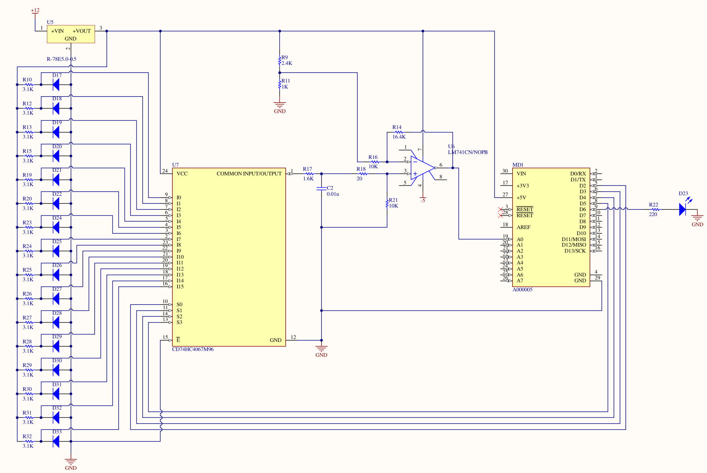

# New Member Design Presentation

Team 1: Rebekah Han, Hank Habashy, Shiven Jariwala, and Dhruv Ajwani

---

# Schematic Flow Chart


---

# Schematic



---

# 1. Temperature Diodes

- Involved a similar setup as to what was written in the datasheet.
- To achieve a forward current of 1 mA with a 5 V source, our needed resistor ended up being 3.1 kΩ instead of 680 Ω.

---

# 2. RC Low-Pass Filter & Differential Op-Amp

- To achieve a cutoff frequency at ~10 kHz
- The op-amp handled level shifting and amplification so that the temperature diode's signal would range from 1 - 4 V
- We would like the lowest temperature (i.e. -40°C) to be 4 V instead of the original 2.44 V (from the diode) and the highest temperature (120°C) to be 1 V instead of 1.30 V. Thus the gain for the op-amp will be 2.63 (= [4V - 1V]/[2.44V - 1.3V]).

---


---

- To get the V_ref, we used a voltage divider
- The V_REF was computed by using the given equation: V_out = A(V_in - V_ref) + V_ref, where A is the gain. In our case, V_in = 1.3 V and V_out = 1.0 V.

---

# 3. Multiplexer & Arduino Nano

- The multiplexer will handle from what diode we will read from at a time
- A digital pin from the Nano will be set to high if any of the temperatures are > 60C

---

# 4. The 12-to-5V Step-Down Converter

- Ours is able to put out 2.5 W.
- By summing the power consumption of elements connected to the 5V line, the estimated sum turns out to be 1.78 W, which is < 2.5 W.
*Since each temperature diode is 3.1 kΩ and is receiving 5 V, all 16 diodes dissipate about 0.129 W. The multiplexer consumes a max of 0.00004 W. The voltage divider consumes 0.00735 W. The op-amp is estimated to consume 0.05 W when the V_s is 15 V. Since ours is at 5 V, we will consume less power than 0.05 W. The Arduino Nano is estimated to consume a total of 1.6 W in our case because we are using 5 digital pins. [Someone](https://arduino.stackexchange.com/questions/926/what-is-the-maximum-power-consumption-of-the-arduino-nano-3-0) calculated that the Nano consumes 1.4 W to turn on, as the datasheet states the typical power consumption is TBC. The additional 0.2 W comes from 5 digital pins consuming each 40 mA max.*

---

# Code

Everything but linear interpolation was done. It's 1 AM right now... ;_;

Several lines excluded!

```cpp
byte selectArray[16][4]; // Hold 0000 in selectArray[0][0-3], 0001 in [1][0-3], etc.
const int selectLines[4] = { 5, 4, 3, 2 }; // Pins to multiplexer select lines

void setup() {
    for (int num = 0; num < 16; num++) {
        for (int bit = 3; bit >= 0; bit--) {
            selectArray[num][3 - bit] = (num >> bit) & 1; // Bit shift num by bit times and mask the lowest bit
        }
    }
}

void loop() {
    float highestTemp = 0;
    int highestTempChannel = 0;
```

---


```cpp
    // For each MUX channel
    for (int i = 0; i < NUM_TEMP_SENSORS; i++) {
        selectMuxChannel(i);
        delayMicroseconds(20);
        float tmpTemp = analogRead(TEMP_PIN);
        // Linear interpolation will need to take place!!!!
        if (tmpTemp > highestTemp) {
            highestTemp = tmpTemp;
            highestTempChannel = i;
        }
        // Turn on LED if the temperature is too high
    }
}

void selectMuxChannel(int channelNum) {
    for (int i = 0; i < 4; i++) {
        digitalWrite(selectLines[i], selectArray[channelNum][i]);
    }
}
```

---

# Thank you!